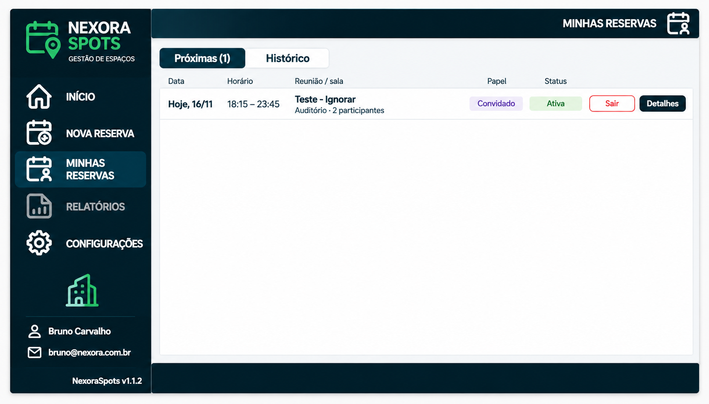
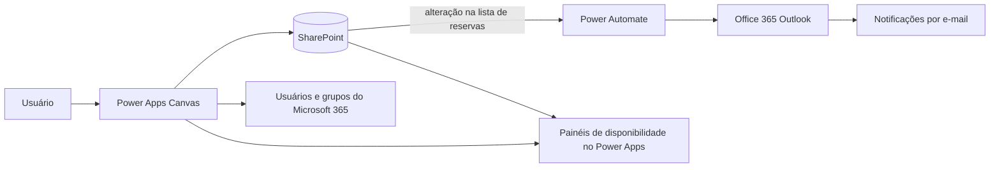

# Nexora Spots

Sistema de gerenciamento e reserva de espaços corporativos construído com Microsoft Power Apps, Power Fx, SharePoint, Power Automate e Microsoft 365.

Este repositório documenta a engenharia e as decisões verificadas em uma solução de portfólio. Ele não distribui o aplicativo original, conexões, dados corporativos ou um pacote instalável.

## Visão geral

O Nexora Spots centraliza a consulta de salas, a criação de reservas e o acompanhamento da ocupação. A solução usa o SharePoint como camada de persistência, fórmulas Power Fx para regras de negócio e um fluxo do Power Automate para notificações por e-mail.

## Funcionalidades confirmadas

- painel com situação das salas, recursos e próximas reservas;
- criação de reservas em intervalos de 15 minutos;
- bloqueio de horários passados e de intervalos sobrepostos;
- seleção de finalidade e participantes do Microsoft 365;
- visão de reservas futuras e histórico mensal;
- cancelamento pelo organizador e saída de participantes;
- edição da lista de convidados pelo organizador;
- administração de capacidade, situação e recursos das salas;
- visão administrativa de reservas e modo de simulação;
- notificações de criação, alteração de participantes, edição e cancelamento por Power Automate.

O comportamento, as restrições e as limitações de cada recurso estão em [Funcionalidades](docs/funcionalidades.md).

## Demonstração visual



As imagens fornecidas contêm metadados C2PA de mídia algorítmica e são apresentadas somente como representação visual da interface, não como evidência de execução. As demais imagens foram deliberadamente retidas porque exibem nomes, endereços de e-mail ou dados cuja natureza fictícia ainda precisa ser confirmada. Consulte [Imagens](docs/imagens.md) antes de publicar novas telas.

## Arquitetura verificada



O aplicativo consulta listas do SharePoint para espaços, reservas e finalidades. Os painéis derivam ocupação e próximos horários das reservas ativas. Um fluxo observa alterações na lista de reservas e envia mensagens pelo Outlook. O acesso inicial também consulta um grupo do Microsoft 365; as permissões efetivas das fontes de dados não puderam ser verificadas no pacote.

Mais detalhes: [Arquitetura](docs/arquitetura.md) e [Power Apps](docs/powerapps.md).

## Tecnologias

- **Microsoft Power Apps Canvas:** interface, navegação e experiência de uso.
- **Power Fx:** validações, filtros, cálculo de horários, coleções e persistência.
- **Microsoft SharePoint:** listas de espaços, reservas e finalidades.
- **Microsoft Power Automate:** tratamento de alterações e notificações.
- **Microsoft 365:** pesquisa de usuários, consulta a grupo e envio pelo Outlook.
- **HTML/CSS incorporado:** composição visual de uma versão do painel de disponibilidade.

Veja [Tecnologias](docs/tecnologias.md) para o papel e os limites confirmados de cada elemento.

## Destaques técnicos

- detecção de conflito pelo predicado de sobreposição `novoInicio < fimExistente && novoFim > inicioExistente`;
- normalização de horários `HH:mm` em minutos para comparação e cálculo;
- separação de reservas futuras, realizadas e canceladas;
- estado local com variáveis globais, variáveis de contexto e coleções;
- componente reutilizável de navegação lateral;
- atualização explícita das fontes e relógio por temporizador;
- tratamento de falhas de gravação com `IfError` e retorno visual ao usuário.

## Estrutura do repositório

```text
.
├── README.md
├── .gitignore
├── docs/                 # documentação publicável e sanitizada
├── screenshots/          # somente imagens aprovadas para revisão final
├── powerapps/            # exemplos demonstrativos de Power Fx
├── power-automate/       # orientação sobre o fluxo, sem exportação corporativa
├── entrada/              # cópias dos originais; ignorada pelo Git
└── internal/             # análises e relatórios restritos; ignorada pelo Git
```

Os artefatos originais preservados na raiz também estão explicitamente ignorados. Nenhum arquivo `.msapp` ou pacote exportado do ambiente corporativo faz parte do conteúdo publicável.

## Documentação

- [Inventário sanitizado](docs/inventario.md)
- [Arquitetura](docs/arquitetura.md)
- [Funcionalidades](docs/funcionalidades.md)
- [Power Apps](docs/powerapps.md)
- [Power Automate](docs/power-automate.md)
- [Tecnologias](docs/tecnologias.md)
- [Revisão de segurança](docs/revisao-seguranca.md)
- [Política das imagens](docs/imagens.md)
- [Exemplos Power Fx](powerapps/exemplos-powerfx.md)

## Natureza e limites do projeto

Esta é uma demonstração técnica para portfólio. O repositório não oferece implantação automática, suporte comercial, garantia de funcionamento fora do ambiente de origem ou direito de redistribuição dos artefatos corporativos. A documentação e qualquer material derivado devem passar por revisão humana e autorização de propriedade intelectual antes de publicação.

Não foi atribuída licença de código aberto.

## Desenvolvimento e contribuições

- **Desenvolvimento:** _preencher após validação de autoria_.
- **Arquitetura/Power Platform:** _preencher após validação de autoria_.
- **Contato público:** _preencher antes da publicação_.
- **Contribuições:** aceitação e processo ainda não definidos.

## Publicação responsável

Antes de enviar este conteúdo ao GitHub, conclua localmente o checklist `internal/checklist-publicacao.md`, confirme que os arquivos ignorados não estão no índice e obtenha autorização para documentação, imagens, marcas, textos e exemplos derivados.
