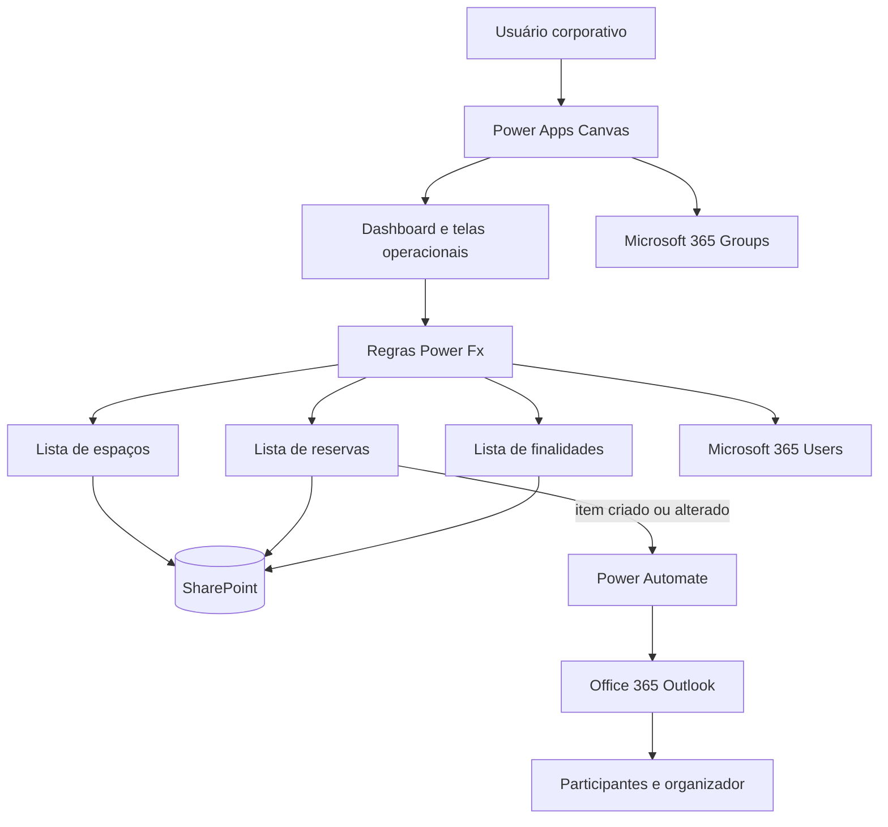

# Arquitetura

## Visão lógica

## Fluxo de dados

1. O Power Apps identifica o usuário atual e consulta um grupo do Microsoft 365 para escolher a tela inicial ou uma tela de acesso negado.
2. O aplicativo carrega espaços, finalidades e reservas de listas do SharePoint.
3. O usuário informa sala, data, início, fim, finalidade e participantes.
4. O Power Fx converte horários em minutos, valida os campos e consulta novamente as reservas ativas da sala e da data.
5. Sem sobreposição, uma nova linha é criada na lista de reservas; cancelamentos e alterações também são persistidos nessa lista.
6. Os painéis filtram as reservas ativas do dia e calculam situação atual, tempo restante e próxima reserva.
7. O Power Automate observa itens criados ou alterados, consulta quais colunas mudaram e envia notificações pelo Outlook.

## Componentes confirmados

### Aplicativo Canvas

O pacote contém oito telas em sua ordem editorial:

- início;
- nova reserva;
- minhas reservas;
- painel administrativo de reservas;
- configuração;
- visão de todas as reservas;
- acesso negado;
- painel de disponibilidade em tempo real.

Há um componente Canvas reutilizável para a barra lateral. A aplicação foi criada para desktop/tablet em layout de 1366 × 768, com escala para ajuste e manutenção de proporção.

### Persistência

Foram confirmadas listas conectadas para espaços, reservas e finalidades. A lista de espaços guarda capacidade, ordem, situação e disponibilidade de câmera, ar-condicionado e TV. A lista de reservas guarda sala, data, horários, duração, finalidade, participantes, solicitante e situação.

### Identidade e diretório

Os conectores Microsoft 365 Users e Groups aparecem no pacote. Users fornece pesquisa, perfil e foto; Groups participa da decisão da tela inicial. Não foi possível validar a governança do grupo nem as permissões efetivas nas listas.

### Automação

O único fluxo exportado usa SharePoint e Office 365 Outlook. Ele trata criação, mudança de participantes, edição e cancelamento. Não foi encontrada ação de criação ou atualização de evento de calendário; a integração confirmada com Outlook limita-se a e-mail.

### Painel para monitor

Um HTML auxiliar incorpora o Power Apps em `iframe`, solicita tela cheia, oculta o cursor após inatividade e recarrega o aplicativo a cada 60 segundos. O arquivo original contém identificadores de ambiente e não foi incluído na área pública.

## Decisões e limitações identificadas

- Horários são armazenados como texto `HH:mm` e convertidos em minutos no cliente.
- Coleções locais reduzem repetição de fórmulas e alimentam galerias e indicadores.
- `Refresh` é chamado antes de validações sensíveis e em carregamentos de telas.
- Uma versão do painel utiliza HTML Text para compor cartões; parte dos indicadores superiores está fixa no código e precisa ser tornada dinâmica.
- O painel interno atualiza o relógio por temporizador, enquanto a atualização completa dos dados do painel em monitor depende do recarregamento feito pelo HTML auxiliar.
- Regras administrativas usam listas de e-mails no cliente. Isso é controle de interface, não uma fronteira de segurança; permissões do SharePoint e compartilhamento do aplicativo precisam ser revisados separadamente.
- A configuração indica limite padrão de 500 linhas e o App Checker registra alertas de delegação. A escalabilidade além desse volume não foi comprovada.

## Aspectos não comprovados

- política de autenticação do tenant;
- permissões das listas e dos itens;
- prevenção de concorrência transacional no SharePoint;
- políticas DLP, retenção e auditoria;
- ambientes de desenvolvimento, teste e produção;
- processo de ALM, soluções e variáveis de ambiente.
