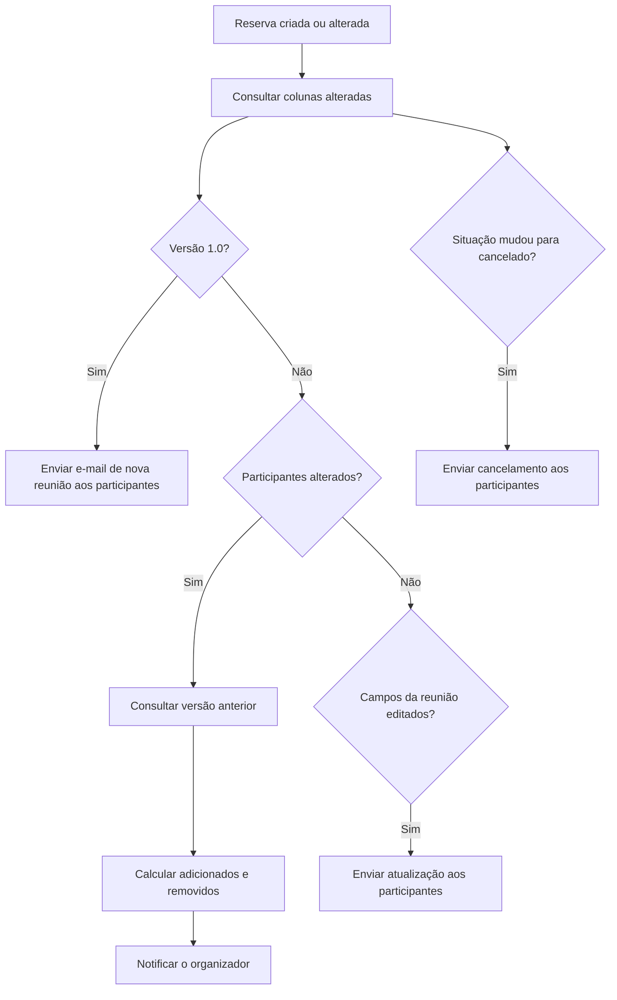

# Power Automate

## Fluxo disponível

Foi encontrada uma exportação de um fluxo de notificações. O pacote contém manifesto, mapa de APIs, mapa de conexões e `definition.json`. A exportação original permanece fora do Git porque contém referências de conexão, conta e SharePoint.

## Integrações confirmadas

- SharePoint;
- Office 365 Outlook.

Não foi encontrada ação de calendário, Teams ou aprovação.

## Gatilho

O fluxo usa a operação de itens criados ou modificados do SharePoint na lista de reservas. A definição exportada registra avaliação a cada cinco minutos e `splitOn`, tratando cada item individualmente.

## Lógica observada

### Criação

Quando o número de versão é `1.0`, o fluxo envia mensagem de nova reunião para a coluna de participantes. O assunto exportado contém um texto literal genérico e deve ser revisado.

### Participantes

Quando a coluna de e-mails de participantes muda, o fluxo consulta versões do item, compõe listas anterior e atual, filtra removidos e adicionados e envia uma mensagem ao organizador.

### Edição

Há um ramo para mudanças de título, sala, data, início, fim e finalidade, seguido de e-mail aos participantes. Contudo, a expressão exportada compara os valores atuais desses campos com `true`, em vez de consultar as flags de alteração. Isso aparenta inconsistência lógica e exige correção/teste no ambiente autorizado.

### Cancelamento

O fluxo verifica se a coluna de situação mudou e se o novo valor é `Cancelado`; então envia e-mail de alta importância aos participantes.

## Dependências

- lista de reservas e seu histórico de versões;
- colunas com nomes e tipos esperados pelo fluxo;
- conexões válidas de SharePoint e Outlook;
- conta remetente autorizada;
- e-mails delimitados de forma consistente na coluna de participantes.

## Limitações

- Exportação criada fora de uma solução e com referências embutidas de conexão.
- Não foram identificados escopos de tratamento de exceção ou registro customizado de falhas.
- Não há evidência de sincronização com eventos de calendário.
- Destinatários de criação e cancelamento vêm da lista de participantes; a inclusão do organizador não é garantida pela definição analisada.
- A definição precisa ser validada com casos de criação, mudança de participantes, edição isolada e cancelamento antes de qualquer demonstração.

Consulte também [Orientação para exemplos](../power-automate/README.md).
